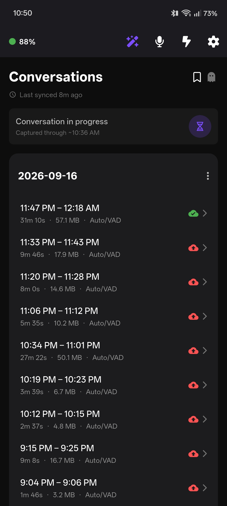

# memrii

**Own your conversations.**

memrii is a local-first conversation capture platform designed to keep the original
recording under the user's control.

Recordings remain local by default. Users decide what is retained, processed, exported,
or shared with connected services.

[memrii.me](https://memrii.me) · **App source:** `0.2.4+15` · **Firmware source:** `memrii-fw-3.2.0`

Prebuilt downloads are not currently published in this repository. See [Building](#building).

---

## Screenshots

<table>
<tr>
<td align="center" width="33%"><br><sub>Conversations</sub></td>
<td align="center" width="33%"><br><sub>Recording Settings</sub></td>
<td align="center" width="33%"><br><sub>App Settings</sub></td>
</tr>
<tr>
<td align="center" width="33%"><br><sub>Device Settings</sub></td>
<td align="center" width="33%"><br><sub>Button Configuration</sub></td>
</tr>
</table>

<sub>Screenshots predate the memrii name and still show the old "Omi Offline" title.</sub>

---

## What memrii is

memrii has three parts, and only the first is tied to a particular piece of hardware:

1. **A capture device running memrii firmware.** Today that is the Omi wearable. It
   records to its own storage whether or not a phone is nearby.
2. **The memrii app** (Android). It pulls recordings off the device over Bluetooth,
   turns them into dated, playable conversations and keeps them on the phone.
3. **Optional destinations.** A connector sends a recording somewhere else — a folder
   you choose, HeyPocket, or Omi Cloud — only after you have turned that connector on,
   and only the recordings you have authorized for it.

The capture → sync → process → playback path needs no account, no subscription and no
network at all.

## Data ownership

- **Local by default.** Every recording is written to the device's own storage and then
  to the phone's app storage. Nothing is uploaded unless you configure a destination.
- **Destinations are opt-in, one at a time.** HeyPocket, Omi Cloud and Save to Folder are
  all off until you set them up. Turning one on does not send anything by itself:
  open a recording and tap Upload or Save to send it to a configured destination.
- **A destination only sees what it was authorized to receive.** The app hands a
  connector one recording it has approved for that destination — never the library. See
  [Sharing and connectors](#sharing-and-connectors).
- **Deleting is yours to decide.** Retention is "keep forever" by default; you can choose
  to delete recordings after a number of days, or as soon as every enabled destination
  has them ("passthrough").
- **No accounts, no billing, no memrii server.** memrii has no backend of its own.

## Current capabilities

- **Offline capture and resumable sync.** The device encodes Opus (16 kHz mono, 20 ms
  frames) into a raw circular log on its storage. The app downloads closed segments over
  BLE with per-file byte-offset bookmarks, so an interrupted sync resumes where it
  stopped.
- **Two recording modes.** Session (the default — explicit Record Start / Record Stop on
  the device button) and Ambient (hands-free; firmware activity detection by default,
  Silero VAD on the phone optionally).
- **Markers.** A button gesture drops a timestamped bookmark into the audio stream; in
  Ambient mode it also forces about a minute of capture around the tap.
- **Priority Recording.** In Ambient mode, Record Start opens a force-captured
  recording until the matching stop, with a device-side safety cap.
- **Timestamp self-correction.** The phone is the device's clock of record: recordings
  the device dated wrongly after a restart are re-dated from a clock anchor, with undo.
- **Discard recovery.** Audio that processing dropped is shown as a "ghost" row and can
  be recovered for 48 h.
- **Local playback, export and sharing** through the system share sheet, plus Save to
  Folder.
- **Local firmware updates** over BLE from a `.zip` you choose.
- **Diagnostics.** An opt-in Debug Tools screen reads the device's live health counters.

The full feature reference follows below.

---

## Supported hardware

- **Omi wearable (Omi Consumer, nRF5340) running compatible memrii firmware.**

memrii replaces the device's firmware; the stock Omi firmware is not compatible with
the memrii app. The firmware in this repository targets the board definitions in
`omi/firmware/boards/omi/` and is flashed over BLE from the app (Device Settings →
Firmware) or by J-Link for recovery (`omi/firmware/FLASH_3.0.8/`).

| Component | Part | Spec |
|-----------|------|------|
| SoC | nRF5340-CLAA | Dual-core Bluetooth LE |
| Wi-Fi | nRF7002-CEAA-R7 | Wi-Fi 6 (present on the board; unused by this firmware) |
| Microphones | MMICT5838-00-012 x2 | TDK top-port PDM |
| NAND Flash | CSNP4GCR01-DPW | 512 MB |
| IMU | LSM6DS3TR-C | 6-axis accel/gyro. The gyro is off and the accelerometer runs in low-power mode — nothing reads the motion data; the accelerometer stays on only because the chip stops its clock counter if both halves idle, and that counter is what bridges a restart |
| Battery | GRP1654M1-1C-1S1P | 3.7 V 150 mAh LiPo |
| Charger | BQ25101YFPR | Li-Ion, magnetic pogo pins |
| Motor | — | 3 V vibration, D5.0×H2.5 mm |

PCB: mainboard (v1.2) + charger board (v1.0) + FPC (v1.0). The hardware design files in
`omi/hardware/consumer/` are Based Hardware's, under their own MIT license.

The app talks to the device through a device adapter (`OmiDeviceAdapter`), so
Omi-specific protocol details stay out of the recording pipeline; another capture device
would be a second adapter. Only the Omi
adapter exists today, and the app manages one paired device at a time.

---

## How it works

```
Capture device (Omi + memrii firmware)
  PDM mics → Opus encoder → SD NAND circular log (.bin segments)
                                   │
                    BLE GATT: list / resumable read / delete (WAL, ACK-gated)
                                   │
memrii app (Android)               ▼
  raw .bin segments on the phone
    → decode + markers + AAD timestamps, or Silero VAD (opt-in)
    → recordings/<YYYY-MM-DD>/recording_<ms>.wav|m4a   ← the local archive
    → playback, export, deletion, retention
    → (only if configured) sharing policy → connector → destination
```

Capture, device communication, recording processing and sharing authorization are separate
layers. Each connector receives a normalized recording and a grant from the sharing policy.

---

## Sharing and connectors

| Destination | Leaves the phone? | What it receives |
|---|---|---|
| Save to Folder | Depends on the selected document provider (local, SD or network-backed) | The finished audio file |
| HeyPocket | Yes | The finished audio file, its start time and duration |
| Omi Cloud | Yes | The recording's Opus frames, in 3-minute chunks |

Every destination is off by default and configured in Settings → Integrations.
Normal builds support manual upload/save, selection export, retries and local retention.
Configure and enable HeyPocket or Omi Cloud to upload recordings, or choose a folder
to save copies. Enabling a destination does not send recordings by itself. Manual
network uploads can use cellular.

**Omi Cloud is unofficial; it may stop working without notice.** Recordings without
the processing-time Opus sidecar cannot be uploaded.

Each destination has its own sequential queue; destinations send concurrently.
A document provider chosen for Save to Folder may itself use a network. Passthrough
deletes local audio only after all available enabled destinations confirm delivery
and never authorizes sending by itself.

No billing or purchases exist yet. Normal Debug, Profile and Release builds use the
production entitlement provider, which currently remains Free, and hide automation
controls. There is no public way to obtain Pro. Debug mode, preferences and public
build flags do not grant it.

Under the hood each destination is a **connector**, and a connector can only send a
recording it holds a grant for. Grants come from one place, the sharing policy: your tap
is a grant for that recording and that destination.
A connector is shown one normalized recording at a time — never the library, and nothing
of how the audio was captured or synced. A third mode, a review queue where each
recording waits for approval, exists in the sharing policy but has no screen yet.

All Pro automation code is included in the source. Pro automates sending through
per-destination rules, Wi-Fi conditions, archive backfill and Omi Cloud Auto-Upload;
the same destinations remain available manually for Free users. AutomationPolicy
checks permission and rules above connector transport; SharingPolicy authorizes
each recording, and queued work rechecks its grant. Losing Pro stops automation
while preserving its saved configuration; manual grants remain valid.

Credentials (the HeyPocket API key, Omi Cloud tokens) live in Android's encrypted secure
storage, never in plain preferences.

---

## Key features in detail

- **Resumable BLE sync (WAL).** Per-file byte-offset bookmarks survive disconnects. Sync resumes from the last trusted byte-offset bookmark, re-fetching bytes when crash recovery or local-file reconciliation requires it.
- **AAD (firmware activity detection).** Ambient mode splits on the firmware's audio-activity timestamps and treats all captured audio as speech — no on-phone model. This is Ambient's default: it processes faster and uses less battery than Silero.
- **Silero VAD on-device (opt-in).** ONNX Runtime can run Silero VAD v6.2.1 locally on the phone to strip silence and segment speech. Disabled by default in Ambient mode; enabling it shows a one-time battery/processing-time warning. Runs in a background isolate so platform threads stay unblocked.
- **Two recording modes.** Session (the default — explicit Record Start / Record Stop on the hardware button) and Ambient (hands-free; AAD by default, Silero optional). Each mode keeps its own button mapping and its own max-length cap; the app pushes the active mode's mapping to the device on connect and on every mode switch.
- **Customizable button mapping.** Single / double / triple tap, plus their press-and-hold variants, are each mappable to one of seven actions (None, Mute, Marker, Toggle LED, Record Start, Record Stop, Record Toggle) from Device Settings → Button Configuration. Each gesture can also be given its own vibration pattern. Both are synced to the firmware over encrypted characteristics on the Settings service and persisted in flash. The 4-tap-and-hold (3 s) Power Off and 5-tap-and-hold (10 s) Unpair gestures are hardware-reserved and cannot be remapped.
- **Mute.** Double-tap-and-hold mutes the mic under the Ambient default mapping (solid red LED); the firmware ignores mute in Session mode, where what is or isn't recorded is already an explicit choice. The app shows a "Muted since H:MM" banner and notification line, exposes a mic-toggle button in the app bar (Ambient mode), and reads/writes mute state live over a BLE Mute service. Muted stretches are written inline into the audio stream and surface as delete-only "Muted" ghost rows on the day they happened.
- **Verified Markers.** The gesture mapped to the Marker action drops a timestamped bookmark inline in the audio stream; during processing the app parses it with sub-frame precision into an EDL sidecar. In Ambient mode a marker is more than a bookmark — the firmware pins the audio gate open for 50 s and the app forces the same window through as speech, so roughly a minute from the tap is captured whatever the threshold and Silero would have decided. In a Session recording it is a plain bookmark. In Session standby there is nothing to bookmark, so the tap is swallowed and nothing is written.
- **Priority Recording.** In Ambient mode, Record Start opens a high-priority capture: the firmware rotates the segment and marks the boundary, and the app finalizes whatever Ambient recording was open and force-captures everything until the matching stop — no silence splitting, rendered red in the list. A firmware-side safety cap (default 2 h, configurable, `0` = none) ends it if the stop never arrives.
- **Timestamp self-correction.** The device has no clock that survives a restart: it learns the time from the phone on connect and falls back to the IMU's counter, which wraps every ~29.8 h in the direction that makes a long gap look short. Whenever a diagnostics read gets through, the app records the device's uptime and session id against the real wall clock and uses that to place every recording from that boot. Recordings that already agree are never touched; only a timestamp the phone can prove wrong is overwritten, and a re-dated recording gets an undo arrow that puts it back permanently. A re-date never renames one recording on top of another — a recording under a wrong date is recoverable, one overwritten is not.
- **Discard recovery (ghost rows).** Audio that processing dropped (silenced as noise, or too short) is surfaced as a greyed-out "ghost" row in the recordings list, appearing in real time as each discard is identified. Source bins are protected for a 48 h window so you can recover a clip with a lower threshold or delete it.
- **Encrypted BLE / single bond.** All sensitive and writable characteristics (offline storage, device settings, button and haptic config, time sync, mute, LED) require a bonded, encrypted connection, so a non-bonded device in range can't read recordings, mute the mic, or change settings. The device keeps a single bond slot (`CONFIG_BT_MAX_PAIRED=1`); the physical 5-tap unpair gesture (or the app's `CMD_UNPAIR`) is what frees it for a new phone. Unpairing is synchronized: "Forget Device" sends `CMD_UNPAIR` (`0x15`) so the device wipes its own bond keys at the same time the phone clears its own.
- **Background battery saving.** When idle, the app normally disconnects BLE after a ~15 s background grace window to allow quick screen-off/on. Active syncs defer the disconnect and receive a fresh grace window when they finish; firmware updates and the firmware-update screen are exempt. It reconnects when a sync is due, or on the next foreground if the last background sync was skipped. The firmware records to the SD NAND regardless of phone connectivity. A `PARTIAL_WAKE_LOCK` is held over the background sync+process run so Android doesn't downclock the processing isolate when the screen is off.
- **Scheduled sync that outlives the UI.** The Dart engine belongs to the `Application`, not to the Activity, so Android reclaiming a backgrounded screen leaves the half of the app that decides to sync still running — otherwise the device stays connected, looks healthy, and nothing is ever collected from it. Three things can trigger a sync (an in-app timer, an Android exact alarm, a WorkManager backstop) and all three read the same record of when a sync last *completed*, so the interval means "since the last sync" whichever path ran it, a manual sync moves the schedule, and a sync that couldn't reach the device is recorded as skipped and retried at the next opportunity rather than pushing the schedule out.
- **Processing resume from checkpoint.** If processing is interrupted (background kill, BLE drop, cancel), the next run picks up from the last completed segment rather than re-decoding from scratch. When the segment list is unchanged it restores the exact Silero LSTM recurrent state with it; when new bins arrived or processed ones were pruned it resumes with fresh state and lets the `_draft` files on disk bridge the gap. A segment is skipped only if it is *both* older than the checkpoint *and* was in the list that checkpoint covered — a segment can arrive after a checkpoint is written and still be older than it, and skipping one on its timestamp alone stranded its audio.
- **Export & share.** Any recording exports through the system share sheet as its on-disk WAV/M4A file; a marker clip is cut to its selected range and shared as a WAV (WAV sources are copied directly; compressed sources are decoded on the phone with Android's built-in media decoder); and each day card has an "Export All" that shares the whole day's recordings at once.
- **Local OTA firmware updates.** Pick a firmware `.zip` from Device Settings → Firmware and flash it to the device over BLE — MCUboot SMP (`mcumgr`) with a legacy Nordic DFU fallback and live install progress. No server round-trip: you flash the zip the build produces. After a successful flash, the app requests removal of the phone's old bond and automatically attempts to find and re-pair the rebooted device. Firmware normally clears its own bond on that next boot. Accept the phone's pairing prompt if shown; if automatic re-pairing does not complete, the success screen offers another search or manual pairing.
- **In-app diagnostics.** An opt-in Debug Tools screen (enabled from App Settings) reads the firmware's counters over the Diagnostics BLE service — SD-queue / block / codec drops, BLE connect failures, marker-write drops, worker stack high-water marks, mic liveness, capture duty cycle, advertising interval, reset cause and uptime — with a "Mark baseline" action, a copyable snapshot, and an optional shareable log file. Current production enables `CONFIG_OMI_DIAG_LOG=y`, exposing the capability-gated event-log characteristics; normal event collection is separately gated by the runtime Debug Tools toggle (off at boot). A dropped link records the last connected RSSI and its age. Fresh RSSI, scan results and recovery actions help assess range loss; RSSI alone cannot identify the failed side.
- **Adjustment Mode.** A Debug Tools switch that sets aside an untouched copy of every raw `.bin` fetched from the device, so a processing change can be re-run against real capture instead of a fresh sync. The archive can be reprocessed in place or exported as a single `.zip` through the share sheet — file count and approximate size are confirmed first, because the bins are already-compressed audio and a week of them will exceed what most share targets accept. It is the only export in the app that hands over raw capture rather than a finished recording.
- **Remote reboot and shutdown.** Device Settings can cold-reboot the device or put it into ship mode over BLE; both close the SD log cleanly first. Ship mode wakes only on a button press or the charger.

### Firmware internals (Zephyr RTOS, nRF5340)

- **Audio:** PDM at 16 kHz → Opus VBR (32 kbps, complexity 3, CELT), 20 ms frames at 50 fps (codec ID `21` = opusFS320). Encoded payload size varies. SD frames have a 4-byte length prefix and payload padding to a 4-byte boundary; BLE storage packets carry slices of that byte stream with their own transport framing. A reported 2026-08-29 capture measured mean payload 87.0 B plus the 4-byte prefix, before alignment/block padding; this is a measurement, not a fixed frame specification. See [fixture framing and measurements](app/test/fixtures/bins/README.md).
- **Storage:** no filesystem. Audio is appended to a raw circular log (`sd_ring.c`) on the 512 MB SD NAND: a 128 KB metadata reserve (format header, 64-slot cursor log, two segment-table copies) followed by an append-only byte ring. This replaced LittleFS, whose block allocator had no persistent free-map and ran a full-filesystem scan — tens of seconds on the single SD worker thread, dropping audio the whole time — exactly when the card was full. Appending is now O(1), nothing ever scans, and the cursor is only advanced after the bytes are durable, so a power cut can lose at most the un-claimed tail. The SD NAND is a separate chip that DFU never addresses, so the log survives firmware updates by construction.
- **SD write pipeline:** frames are assembled into 440 B blocks and queued on `sd_msgq` (depth 120); BLE reads use a separate priority queue (depth 10). The worker drains up to 16 further writes per wake, and syncs the ring cursor at most every 60 s. A write-fairness rule forces a write turn after a run of reads so an active BLE sync can't starve audio. The SPI bus is woken lazily — an append that fits the staging buffer is just a memcpy — and suspended after each burst; the NAND is only fully powered off at shutdown.
- **Security:** sensitive GATT characteristics (storage, settings, button/haptic config, time sync, mute, LED) are encryption-gated and require a bond, so a non-bonded device can't read recordings or change settings. The device keeps a single bond slot (`CONFIG_BT_MAX_PAIRED=1`), and `CONFIG_BT_ID_UNPAIR_MATCHING_BONDS` makes a re-pair from the same address replace the matching bond rather than pile up. A 5-tap-and-hold (10 s) gesture, or the app's `CMD_UNPAIR`, wipes all bonds from NVS.
- **Time sync:** on BLE connect the app writes UTC as a little-endian `u32` to characteristic `0x0031` (`0x0032` reads it back). The firmware sets its RTC and rotates to a fresh UTC-keyed segment, so everything after the sync is dated. Segments recorded before it keep their uptime key — there is no directory to rename, and their real timing is recoverable from the inline `0xFFFFFFFB` header — so they surface in the app under "Unorganized" until a clock anchor can place them.
- **LED:** the master gate lives in RAM and is seeded at boot from a persisted default, which ships as off (stealth) — so the LEDs come up dark after the boot-sequence flash (white breathe → solid white → fade) unless you change that default from the app. The gesture mapped to Toggle LED flips the gate for the session without touching the default. A separate switch turns off the solid-blue connected indicator, which lets recording / mute / battery state show through while the phone is attached.
- **Button:** Interrupt-driven (no 25 Hz polling). GPIO callback wakes a counter-based FSM only on press. Tap-count + hold resolves against the customizable mapping synced from the app; 4-tap-hold (Power Off) and 5-tap-hold (Unpair) are reserved and bypass the mapping.
- **Battery:** ADC read every 60 s when connected, 5 min when disconnected. Charging state is notified on the same cadence, and keeps flowing during a file sync. Recording continues down to the critical-voltage clean shutdown (with one durable flush at the low-battery threshold) rather than pausing early.

### App internals (Flutter, Android)

- **Native BLE bridge.** Pigeon-generated code calls the platform's native Android Bluetooth stack directly, bypassing Dart BLE library limitations. (Android is the only supported platform — iOS support was removed.)
- **Connection serialization.** `DeviceService.ensureConnection()` uses a `Mutex` so N concurrent callers (battery, storage, WAL sync) share one attempt.
- **Background lifecycle.** Pressing Back minimizes the app (keeps the BLE foreground service running); swiping from Recents still stops it. The app normally disconnects idle BLE ~15 s after going to background; firmware updates and the firmware-update screen are exempt. While a sync holds the link, the timer re-checks every 3 s and gives a full 15 s grace once it goes idle. Reconnects follow the auto-sync schedule or app open. A skipped background sync (couldn't connect) is tracked separately from the last successful sync, so the next foreground reconnects immediately instead of waiting out the interval.
- **The Flutter engine outlives the Activity.** `MyApp` (the `Application`) creates and caches exactly one `FlutterEngine`; `MainActivity` adopts it by id and never destroys it (`shouldDestroyEngineWithHost = false`). Android reclaiming a backgrounded Activity therefore detaches the UI and leaves Dart running — which is what every sync path needs, since they are all Dart-side while the native foreground service keeps the process alive with or without a screen.
- **WAL sync (`SDCardWalSyncImpl`).** Saves segments to `raw_segments/<timerStart>/<timerStart>_<sessionId>.bin`, where `timerStart` is the firmware-assigned UTC epoch seconds and `sessionId` is the 32-bit device session ID (or `0` if unknown). Pre-time-sync files land in a `raw_segments/session_<sessionId>/` fallback folder shown in the UI under "Unorganized". A file listing that goes unanswered is distinguished from a device that genuinely holds nothing, and a listing that arrives short of its own declared count is reported as a partial sync.
- **VAD processor (`VadAudioProcessor`).** Runs in a fresh isolate, with compatible state restored from `vad_checkpoint.json` and drafts/source membership supplied by `RecordingsManager`. It parses inline button, session-end, mute, Priority Recording and resume markers alongside audio. Silence/caps, session transitions and resume/gap handling also affect boundaries. End-of-run flushes in-progress audio as a `_draft` for continuation.
- **Foreground-service resilience.** A single persistent notification (owned by the native BLE foreground service) covers the full sync/processing cycle and survives BLE disconnects, backgrounding, and swipe-away. A native `AlarmManager` exact alarm and a WorkManager job back up the Dart timer when Android freezes the Dart isolate.
- **Recordings manager.** Parses finalized recordings (`.wav` by default; `.m4a` if configured) from `recordings/` for UI binding. Each recording carries a `.meta` sidecar holding its waveform, duration, session id, flag bits (recording mode, forced sync, cap-ended, clock-corrected) and the raw bins it was built from; marker EDL sidecars and the day's discard ledger live alongside.

---

## Recording Modes

### Session (default)

Press the gesture mapped to **Record Start** to begin and **Record Stop** to end — double-tap and triple-tap under the default Session mapping. The LED flashes green on start and red on stop, and shows solid yellow while recording (unless the phone is connected and the connected-LED indicator is on, which takes priority).

- Start sets the AAD threshold to `65535` (always-on) so the firmware never suppresses audio while recording; stop returns it to `32769` (Session standby). Both values mark Session mode.
- Stopping emits a `0xFFFFFFFC` session-end marker **and rotates the segment**, so the bin holding that marker is listable on the next sync and the processor can finalize without waiting for a silence timeout. (Without the rotate, the last bin of a Session recording — the one carrying its own stop marker — stays unlistable until something else writes.)
- The app treats the captured span as one recording regardless of Silero VAD output.
- Mute is ignored by the firmware in Session mode. Marker works inside a recording and is swallowed in standby.
- AAD Sensitivity and certain VAD settings are hidden in the UI.
- A single **Record Toggle** action can replace the separate Start/Stop pair — enable "Single recording button" and both mode mappings are normalized so the picker and the firmware never hold an action that doesn't apply.

### Ambient

The device monitors audio continuously. The LED stays off until audio above the AAD threshold wakes the mic pipeline (yellow = recording, when disconnected). The gesture mapped to Marker drops a white-flash bookmark.

- **AAD is the default:** the app treats every captured frame as speech and splits only on the firmware's activity timestamps. No on-phone model runs.
- **Silero VAD is opt-in.** Enabling it (in Recording Settings) shows a one-time warning that Silero uses more battery and takes longer to process. When on, it segments speech from silence and splits on `vadSplitSeconds` of continuous silence (default 2 min).
- Either way, an optional max-length cap (`vadMaxConversationMinutes`, off by default) can force a split even without silence.
- A **marker also protects audio**: the firmware pins the gate open for 50 s and the app forces the matching window through as speech, so ~60 s from the tap survives regardless of threshold or Silero.
- **Record Start opens a Priority Recording**: the firmware rotates the segment and writes a `0xFFFFFFF8` boundary, the app finalizes the Ambient recording in progress and force-captures — no silence splitting, shown red — until the matching stop or the firmware's safety cap (default 2 h).
- Recordings accumulate across sync cycles — partial in-progress recordings are re-processed each run.

---

## Button Mapping

Most tap gestures are remappable from **Device Settings → Button Configuration**. Each of six gestures can be assigned one of seven actions and its own vibration pattern; both are written to the device live over encrypted characteristics and persisted in the firmware's flash, so they survive reboots and reconnects.

### Actions

| # | Action | Effect |
|---|--------|--------|
| 0 | None | No-op |
| 1 | Mute | Toggle mic mute — solid red LED, mic paused (ignored by the firmware in Session mode) |
| 2 | Marker | White-flash + timestamped bookmark written inline into the audio stream. In Ambient mode it also forces ~60 s of capture from the tap; in Session standby there is nothing to bookmark, so nothing is written |
| 3 | Toggle LED | Toggle the LED master gate for this session (the persisted boot default is unchanged) |
| 4 | Record Start | Session: green-flash, start a recording. Ambient: open a Priority Recording |
| 5 | Record Stop | Red-flash, stop the recording and emit a `0xFFFFFFFC` session-end marker |
| 6 | Record Toggle | Stop if anything is recording, else start — the "Single recording button" option. Requires firmware advertising the `recordToggle` capability bit |

### Gestures & default mapping

The firmware holds one active mapping; the app owns one per mode and pushes the active one on connect and on every mode switch.

| Gesture | Session default | Ambient default |
|---------|----------------|-------------------|
| Single tap | None | None |
| Single tap + hold (1 s) | Marker | Record Start |
| Double tap | Record Start | Marker |
| Double tap + hold (1 s) | Toggle LED | Mute |
| Triple tap | Record Stop | Toggle LED |
| Triple tap + hold (1 s) | None | Record Stop |

The mapping is a 6-byte array — one action index per gesture, in the order above — read and written on the Settings service (`19b10010-…` / char `19b10015-…`); the parallel haptic map (`…0016`, `0` off, `1` single, `2` double, `3` triple buzz) sits beside it. Both require a bonded/encrypted connection, and the firmware validates every value before applying it. These moved here from the retired `23ba7926-…` service in app 0.26.x — the byte layouts are unchanged, but the move required a re-pair. The settings page only allows edits while the Omi is connected, and a change that can't reach the device is reverted so the UI always mirrors what's actually on the firmware.

### Reserved gestures (not remappable)

Two long-hold gestures are hardware-enforced and bypass the custom mapping:

| Gesture | Action |
|---------|--------|
| 4-tap + hold (3 s) | **Power off** — shuts the device down |
| 5-tap + hold (10 s) | **Unpair** — wipes all BLE bonds (3× red blink + 1 s vibration) |

Over-tapping past 5 is a harmless no-op.

---

## LED State Machine

Priority order (highest wins):

| Priority | Condition | LED |
|----------|-----------|-----|
| 1 | Device off | Off |
| 2 | Fatal SD fault | Blinking Red (~500 ms) — overrides stealth / mute / flash / charging; the blink distinguishes it from solid-red mute |
| 3 | Flash event | ~1 s flash, overrides stealth. White = marker; Green = recording start; Red = recording stop |
| 4 | Stealth (LED gate off, not charging) | Off |
| 5 | Muted | Solid Red |
| 6 | Low battery (< 10%) | Solid Purple |
| 7 | BLE connected **and** the connected-LED indicator is enabled | Solid Blue (wins over recording state) |
| 8 | Session recording active (AAD threshold = 65535) | Solid Yellow |
| 9 | AAD Ambient recording (`aad_is_recording()`) | Solid Yellow |
| 10 | Idle, or Session standby | Off |

**Charging overlay** (applied on top of base state):
- Fully charged (>= 98%): Solid Green
- Charging: 500 ms blink between Green and current base color

Charging **bypasses the stealth gate at display time** rather than turning the gate on — so the charge indicator shows in stealth without mutating the stored state, and unplugging can't drop a live mute indicator. Muting does force the gate on, so a mute tap always gives feedback from the default-off state; Toggle LED can still turn it back off mid-mute.

**Button actions** that drive these LED states (marker flash, record start/stop, mute, LED toggle) are user-configurable — see [Button Mapping](#button-mapping) for the gesture map, available actions, and reserved gestures.

---

## BLE Sync Protocol

The firmware's custom services keep the Omi base UUID `19b100xx-e8f2-537e-4f6c-d104768a1214`, and the device still advertises the name `Omi` plus the Settings service (`0010`) — the app matches on either. Neither changed with the memrii name: they are what already-paired devices and installed apps recognise. Characteristics marked 🔒 require a bonded/encrypted connection. There is no live audio-stream service in memrii's firmware — audio goes Mic → SD → storage-sync, never a BLE stream.

Handle stability matters here: Settings is registered early (third, behind only the button and haptic services), so a new characteristic on it shifts every later service's handles and costs a re-pair. New attributes belong on the last-registered service, which is why `0080` exists and why the unused Button service is kept rather than removed.

| Service | UUID suffix | Purpose |
|---------|-------------|---------|
| Settings 🔒 | `0010` / `0011`–`0016` | `0011` LED dim ratio, `0012` mic gain, `0013` AAD/VAD threshold, `0014` Priority Recording safety cap (u16 LE minutes, `0` = none), `0015` 6-byte gesture→action map, `0016` 6-byte gesture→haptic map |
| Features | `0020` / `0021` / `0022` | `0021` capability bitfield — the app hides UI the firmware can't honour (`recordToggle` gates the single-button option, `diagLog` the event-log toggle, `ledService` the two LED switches); `0022` codec ID |
| Time sync 🔒 | `0030` / `0031` / `0032` | `0031` write epoch (u32 LE); `0032` read it back |
| Battery detail | `0050` / `0051` | Notify 1 byte: uint8 charging 0/1 |
| Diagnostics | `0060` / `0061` / `0062` / `0063` / `0064` | `0061` reset cause + previous-session duration (8 B). `0062` 100 B of append-only u32 counters — SD/codec/BLE drops, marker-write drops, stack high-water marks, mic liveness, capture duty cycle, advertising mode, and the boot's device session id. `0063`/`0064` drain and gate the configuration/capability-gated event log; current production enables `CONFIG_OMI_DIAG_LOG=y`, with a separate runtime toggle. |
| Mute 🔒 | `0070` / `0071` | Read/Write/Notify 9 B: `[muted][since_utc_s LE][since_uptime_ms LE]` |
| LED 🔒 | `0080` / `0081` / `0082` | `0081` connected-LED indicator on/off (default on); `0082` boot value of the LED master gate (default off). Registered last, so adding to it moves no existing handle |
| Storage 🔒 | `30295780-…` | File list + read/delete, and the device-control commands below |
| Button | `23ba7924-…` / `23ba7925-…` | Registered but unused in both directions — the firmware notifies no tap events and the app never reads or subscribes. Button state reaches the app as inline markers in the audio stream instead, which is what a recorder built to run disconnected needs. Kept because it registers early, so removing it would shift every later handle and cost a re-pair |

The accelerometer service is compiled out (`CONFIG_OMI_ENABLE_ACCELEROMETER=n`); the IMU chip itself stays powered in low-power mode purely for its clock counter, which is what lets uptime bridge a restart.

**Storage commands** (write to `storageDataStreamCharacteristicUuid`):

| Command | Byte | Payload |
|---------|------|---------|
| STOP_SYNC | `0x03` | — |
| LIST_FILES | `0x10` | — (up to 150 entries; the segment currently being written is **not** listed) |
| READ_FILE | `0x11` | `[cmd, fileNum, offset_4B LE, timestamp_4B LE]` |
| DELETE_FILE | `0x12` | `[cmd, fileNum, timestamp_4B LE]` |
| ROTATE | `0x13` | — |
| CLEAR_STORAGE | `0x14` | — |
| UNPAIR | `0x15` | — (firmware calls `bt_unpair()` and drops the link) |
| REBOOT | `0x16` | — (ACKs, closes the SD log cleanly, then cold-reboots) |
| POWER_OFF | `0x17` | — (ACKs, then ship mode; wakes on button or charger) |
| *(retired)* | `0x18` | Was ARM_POST_DFU_UNPAIR. Answers `INVALID_COMMAND`; the opcode is not reused, because older app builds still emit it |
| KEEP_ALIVE | `0x32` | — (resets the firmware's 60 s idle-disconnect timer) |

File indices are cache positions (0-based, rebuilt after every LIST and every delete). Supplying the timestamp in READ and DELETE lets the firmware re-locate the file by timestamp if the index shifted.

**Post-DFU bond reset is requested regardless of version changes.** The device arms a next-boot wipe from `DFU_PENDING`; on flash success the app stops native reconnect, requests phone-side bond removal, and waits for a new advertising sighting before attempting to reconnect. Bond clearing can fail if firmware cannot persist its wipe flag or Android rejects the removal request. A successful flash therefore does not guarantee successful re-pairing: accept the phone's pairing prompt if shown, or use the success screen's search/manual-pairing options. The device's single occupied key slot can refuse a fresh pairing, so this reset policy also applies to same-version reflashes.

---

## Settings Reference

### Recording Settings

| Setting | Pref key | Default | Notes |
|---------|----------|---------|-------|
| VAD enabled (Ambient mode) | `auto_vadEnabled` | false | On = run Silero; off (default) = AAD, split on firmware timestamps only. Enabling prompts a one-time battery warning. |
| Speech sensitivity | `vadSpeechThreshold` | 0.5 | Silero cutoff (0–1). Lower = more sensitive. |
| Silence to split | `vadSplitSeconds` | 120 s | Silence duration triggering a new recording |
| Min length | `filterMinDurationSeconds` | 0 s | Recordings shorter than this are discarded |
| Max length | `auto_` / `manual_vadMaxConversationMinutes` | 0 (off) | Hard cap; forces a split even without silence. `0` = no cap. Persisted per mode; mirrored into the legacy `vadMaxConversationMinutes` key the processor reads. |
| AAD threshold | `autoVadThreshold` | 250 | Firmware audio-activity gate; mode-specific overrides persisted separately |
| Recording mode | `manualMode` | true | Session is the default. The app pushes this mode's button config and VAD threshold on connect and on every switch |

### App Settings

| Setting | Pref key | Default | Notes |
|---------|----------|---------|-------|
| Recording format | `audioSaveFormat` | wav | Output container: `wav` (PCM, default) or `m4a`. A legacy `ogg` value is coerced to `wav` |
| Recording Retention | `keepRecordingsDays` | -1 | -1 = forever, 0 = delete immediately after upload |
| Background sync interval | `backgroundSyncIntervalMinutes` | 30 | How often a background sync becomes due, measured from the last *completed* sync — a manual one counts. `-1` = Manual Only: no schedule, no exact alarm, and the foreground service falls back to connection-only |
| Show recording mode | `showRecordingMode` | true | Label recordings `Session` / `Ambient/VAD` / `Ambient/AAD` instead of a bare `VAD`/`AAD` |
| Single recording button | `combineRecordButton` | false | Swap the split Record Start/Stop picker options for one Record Toggle; flipping it normalizes both mode mappings |
| Debug menu | `showDebugMenu` | false | Reveals the Debug Tools screen in the drawer |

---

## Building

Android is the only supported app platform (iOS support was removed).

```bash
cd app && bash setup.sh android   # first-time setup and run (dev flavor)
cd app && flutter run --flavor dev # run on a connected phone
cd app && bash test.sh            # unit tests (runs pub get + code generation first)
cd app && dart analyze            # static analysis
```

Build an ordinary Free APK using the public entry point:

```bash
cd app
flutter build apk --debug --flavor dev --target lib/main.dart
# Production, after configuring your own signing key:
flutter build apk --release --flavor prod --target lib/main.dart
```

The APKs are written to `app/build/app/outputs/flutter-apk/`. Production signing
reads `MEMRII_STORE_FILE`, `MEMRII_KEY_ALIAS`, `MEMRII_STORE_PASSWORD`, and
`MEMRII_KEY_PASSWORD`, or local `app/android/key.properties`. Keep keys and
passwords outside Git. The Windows helper `app/scripts/build-release.ps1` can
load your key and Windows-encrypted password from `$HOME/.memrii/keys/`.
CI builds directly with Flutter and uses repository signing secrets.

Firmware builds require nRF Connect SDK v2.9.0 and MCUboot's public sample
signing key, which the SDK includes. Build and flashing instructions: see
[`omi/firmware/BUILD_AND_OTA_FLASH.md`](omi/firmware/BUILD_AND_OTA_FLASH.md).

When publishing APK and firmware updates, use separate GitHub release entries and version numbers:

- **APK:** `memrii-v<pubspec-version>` (including the Android build number, e.g.
  `memrii-v0.2.4+15`), titled `memrii APK 0.2.4`. Pushing an app tag runs the
  Release APK workflow, which creates an APK-only draft for release notes and publishing.
- **Firmware:** `memrii-fw-v<firmware-version>` (e.g. `memrii-fw-v3.2.0`), titled
  `memrii Firmware 3.2.0`. Build locally, then attach only the matching firmware ZIP
  to that release. Firmware tags do not run the APK workflow.

For example, after building firmware 3.2.0, create its draft from the source commit
used for the build (omit `--draft` when publishing):

```bash
gh release create memrii-fw-v3.2.0 releases/memrii-fw-3.2.0.zip \
  --target "$(git rev-parse HEAD)" --title "memrii Firmware 3.2.0" \
  --draft --latest=false --notes-file firmware-release-notes.md
```

Keep the latest APK marked as GitHub's latest release; firmware releases use
`--latest=false`. An app-only update does not re-upload unchanged firmware.

Format before committing — there is no pre-commit hook:

```bash
dart format --line-length 120 <files>   # Dart (skip *.g.dart / *.gen.dart)
clang-format -i <files>                  # firmware C
```

---

## Repository structure

```
.
├── app/                    # memrii app (Flutter, Android)
│   ├── lib/
│   │   ├── backend/        # Preferences, device schema
│   │   ├── capture/        # Capture policy (what each recording mode means)
│   │   ├── gen/            # Pigeon-generated platform channel code
│   │   ├── integrations/   # Connector boundary, sharing policy, upload engine
│   │   │   └── connectors/ # Save to Folder, HeyPocket, Omi Cloud
│   │   ├── models/
│   │   ├── pages/          # UI screens (recordings, settings, firmware update)
│   │   ├── providers/      # DeviceProvider
│   │   ├── services/
│   │   │   ├── devices/    # Device adapter boundary, transports, discovery
│   │   │   │   └── omi/    # The Omi adapter and its BLE protocol
│   │   │   ├── wals/       # Resumable storage sync
│   │   │   ├── recordings_manager.dart
│   │   │   ├── device_clock_anchor.dart
│   │   │   └── vad_audio_processor.dart
│   │   ├── utils/
│   │   └── widgets/
│   ├── android/            # Native BLE stack, foreground service, VAD runner, AAC encoder
│   ├── test/
│   ├── third_party/        # Vendored flutter_onnxruntime
│   └── assets/models/      # Silero VAD model (see its README for hashes)
├── omi/                    # Everything specific to the Omi hardware
│   ├── firmware/           # memrii firmware for the Omi (Zephyr, nRF5340) + board files
│   └── hardware/consumer/  # Based Hardware's Omi Consumer design files (MIT)
├── releases/               # Local generated APK/firmware outputs (ignored)
├── CHANGELOG.md
└── THIRD_PARTY_NOTICES.md
```

The directory is still named `omi/` because everything under it is specific to the Omi
hardware, and its paths are baked into the build scripts and board definitions.

---

## Changelog

See [CHANGELOG.md](CHANGELOG.md) for the per-version history.

---

## Third-party attribution

memrii contains software originally derived from the Based Hardware/Omi open-source
project and remains subject to the MIT license in [LICENSE](LICENSE). memrii is an
independent project and is not affiliated with or endorsed by Based Hardware/Omi.
Vendored and bundled third-party components are listed in
[THIRD_PARTY_NOTICES.md](THIRD_PARTY_NOTICES.md).

---

## Project history

memrii began as **omi-offline**, a personal fork of
[BasedHardware/omi](https://github.com/BasedHardware/omi) rebuilt around local, private
capture: the upstream cloud sync, OAuth, transcription and memory backend were removed
in favour of the offline pipeline above, the live BLE audio stream was replaced by
SD-card capture with resumable sync, and the firmware's storage was rewritten as a raw
circular log. Only the Opus codec and the nRF5340 board files remain close to upstream.

The last omi-offline release was app 0.37.7 with firmware oo-3.1.5, tagged
`omi-offline-final` in the [historical repository](https://github.com/john-gitdev/omi-offline).
This repository begins with a clean memrii release snapshot. Applicable upstream notices
remain in [LICENSE](LICENSE), [THIRD_PARTY_NOTICES.md](THIRD_PARTY_NOTICES.md), and component
license files.
